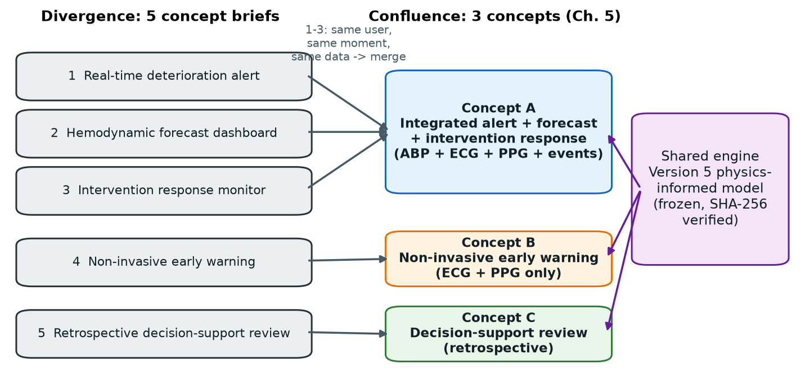

# 03 Concept generation

*BMED Chapter 5: divergence (generating ideas), then post-processing and confluence of ideas (5.5), concept iteration (5.6) and documenting concepts (5.11).*

## 1. Divergence: the five concept briefs

The source document `hemodynamic_app_concepts.docx` proposes five ways to deploy the same model:

| Brief | Clinical role | Main outputs | Brief's own concern |
|-------|---------------|--------------|---------------------|
| 1 Real-time deterioration alert | Watches monitor signals; alerts on forecast deterioration | Stable / Watch / Deteriorating / Critical; forecast MAP and ABP; R, C; signal quality | Must gate alerts by signal quality to avoid alarm fatigue and false confidence |
| 2 Forecast dashboard | Shows current state and predicted trend | MAP trend, ABP forecast curve, R, C, history | May be less impactful if it only displays and never notifies |
| 3 Intervention response monitor | Shows whether the patient improves after treatment | Improving / no clear response / possible worsening; ΔMAP, ΔR, ΔC; timeline | Needs reliable event timestamps; must support review, never prescribe |
| 4 Non-invasive early warning | ECG + PPG when there is no arterial line | Risk score, estimated MAP, confidence, missing-input warnings | Lower certainty without ABP; must show confidence clearly |
| 5 Decision-support review system | Stores forecasts, alerts and markers for review, handoff, audit | Episode summaries, alert history, R/C trends, exportable report | Less useful at the bedside unless paired with real-time alerting |

## 2. Functional decomposition

To see where the briefs overlap, each was broken into the functions it performs (a function–means view, BMED 5.7):

| Function | 1 | 2 | 3 | 4 | 5 |
|----------|---|---|---|---|---|
| F1 Acquire waveforms (ECG, PPG) | ● | ● | ● | ● | ○ stored |
| F2 Acquire invasive ABP | ● | ● | ● | – | ○ stored |
| F3 Check signal quality | ● | ● | ● | ● | ● |
| F4 Forecast MAP / ABP 15 s ahead | ● | ● | ● | ● | ● |
| F5 Estimate R, C | ● | ● | ● | ● | ● |
| F6 Classify risk and raise an alert | ● | – | – | ● | – |
| F7 Explain the forecast visually | ○ | ● | ○ | ○ | ● |
| F8 Detect and assess treatment response | – | – | ● | – | ● |
| F9 Record and export the episode | – | – | – | – | ● |
| Time of use | real time | real time | real time | real time | after the event |
| Setting | ICU / OR | ICU / OR | ICU / OR | step-down / ward | any |

● core function, ○ partial, – absent

## 3. Confluence: why 1 + 2 + 3 merge and 4 and 5 stay separate

BMED 5.5 recommends grouping ideas that share a purpose and recombining partial solutions. The test applied here was simple: **would the same user, at the same moment, with the same data, want these functions together?**

- **Briefs 1, 2 and 3 → Concept A.** All three serve the same bedside clinician, in real time, with an arterial line. Each covers a weakness the brief itself names in another:
  - 1 alerts but needs to *show why* → 2 supplies the forecast display (F7);
  - 2 displays but "may be less impactful if it does not notify" → 1 supplies the alert (F6);
  - 3 shows treatment response, which is what a clinician needs straight after acting on an alert from 1 (F8).

  The brief recommended combining 1 and 3. This design goes one step further and also absorbs 2, because a dashboard on its own fails the brief's own impact concern. Inside an alerting app, the dashboard becomes the *explanation* for each alert (Nielsen heuristic 1, visibility of system status).
- **Brief 4 → Concept B.** It has a different setting and a different input set (no ABP). Merging it into A would hide a large accuracy difference behind one interface. It stays a separate concept so that it can be evaluated on its own merits. (Concept A automatically falls back to the ECG + PPG regime if the arterial line fails, so B's engine also exists inside A as a degraded mode.)
- **Brief 5 → Concept C.** It runs at a different time: after the event, not at the bedside. Its users (quality officers, the next shift) and its risks are different. It stays separate.

## 4. The three concepts

| | Concept A: Integrated monitor | Concept B: Non-invasive | Concept C: Episode review |
|---|---|---|---|
| Combines briefs | 1 + 2 + 3 | 4 | 5 |
| Inputs | ABP + ECG + PPG + intervention events | ECG + PPG | Stored ABP, ECG, PPG, events |
| Setting | ICU, operating room | Step-down, recovery, lower resource | Any setting with records |
| Mode | Real time, 1 s updates | Real time, 1 s updates | Retrospective batch |
| Key outputs | Alert level with reason; 15 s forecast with uncertainty band; P(MAP < 65); R, C trends; intervention response; event log | Risk score with confidence; estimated MAP; missing-input panel; alert capped at WATCH | Handoff narrative; time in each state; alert episodes; intervention table; printable report, CSV, JSON |
| Shared engine | Version 5 model, risk controls RC-07 to RC-10, domain calibration | same | same (runs Concept A's pipeline over the whole record) |

All three share one engine (`app/engine/`). Differences between them therefore come from the concept, not from implementation quality. This matters for a fair selection (BMED 6.4: compare concepts on equal footing).

## 5. Concept iteration (BMED 5.6) during prototyping

Building working prototypes early (BMED 6.5.1, feasibility tests) changed the concepts before the final selection:

| Iteration | Found by | Change |
|-----------|----------|--------|
| B raised many false alarms when it used A's thresholds | first prototype run | Confidence-capped priority: a low-confidence estimate can raise at most WATCH |
| The intervention channel cannot tell a vasopressor from a fluid bolus | Version 5 data inspection | Response tracking driven by an event log, with confounding flags |
| VitalDB pump-rate data are sparse (missing values read as 0) | real-data replay | Sample-and-hold of pump rate, used for event detection only |
| A 40% PPG drop-out passed the Version 5 quality gate | verification | RC-07 raw-signal pre-check |
| Version 5 rejected genuine arterial pressure in profound shock | verification (hazard H-09) | RC-08 hold, RC-09 shock-aware check, RC-10 measured-pressure floor |
| Simulation calibration did not transfer to real patients | verification | Domain-specific calibration |

## 6. Documentation

Each concept is documented as a running prototype (`#/concept-a`, `#/concept-b`, `#/concept-c` in the app). Screenshots are in `docs/figures/ui0*.png`, and the source is in `app/`.
