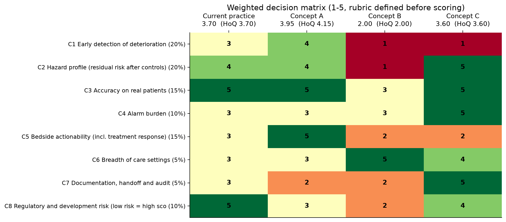
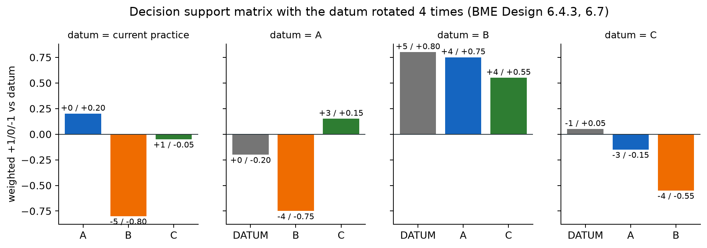
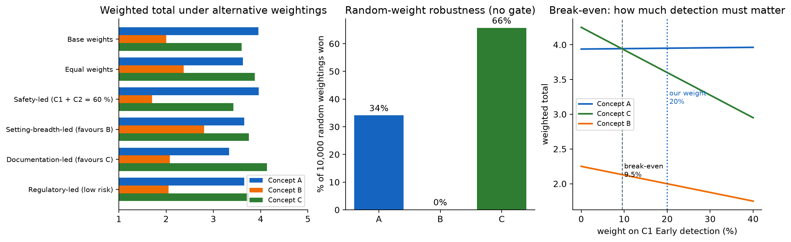
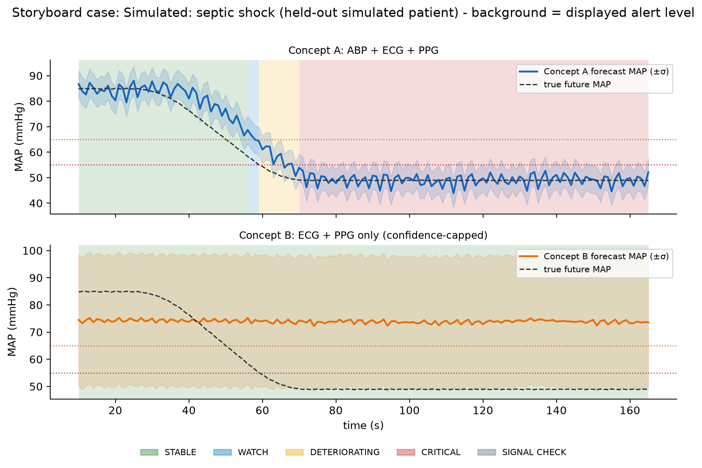

# 04 Concept selection

*BMED Chapter 6: initial screening (6.2), qualitative screening (6.3), quantitative screening (6.4: weighted decision matrix, decision support matrix, scoring systems, House of Quality), proof-of-concept prototypes (6.5.1), storyboarding (6.6.1) and the Design History File (6.8).*

**Decision: Concept A, with Concept C's review report folded in as its documentation module. Concept B is deferred.**

Every score below is computed by `evaluation/concept_selection.py` from the held-out verification results (`evaluation/results/concept_selection.json`). None was typed in by hand.

## 1. Order of methods

BMED 6.4.1 warns that numerical matrices can create false precision, so the selection was run in layers. Each layer is a different kind of evidence:

1. **Initial and qualitative screening** (6.2, 6.3): risks that are hard to quantify.
2. **Critical-specification gate** (6.5.1): a concept that fails a must-meet (\*) specification "will not solve the problem", whatever its score.
3. **Weighted decision matrix with a pre-defined rubric** (6.4.2, 6.4.4).
4. **Decision support matrix, with the datum rotated through all four options** (6.4.3; the rotation advice comes from the §6.7 case study).
5. **House of Quality roof** for coupled criteria (6.4.5).
6. **Sensitivity analysis**: does the answer depend on our weights or on our judgement calls?

## 2. Initial and qualitative screening (BMED Tables 6.1 and 6.3 format)

| Factor | Concept A | Concept B | Concept C |
|--------|-----------|-----------|-----------|
| Technical feasibility | **Low risk**: prototype works; model accurate with ABP | **High risk**: no pressure reference; MAE 12.6–18.8 mmHg | **Low risk**: reuses A's pipeline |
| Core competencies | Signal processing + ML + alarm design: in team | Same, but needs new sensing research | Data/reporting: in team |
| Development time | Medium: three subsystems to validate | Long: needs model research first | Short |
| User need met | Bedside early warning + treatment feedback (N1, N3, N4) | Early warning where there is no arterial line (N8), but unreliably | Handoff and audit (N9); does not protect in real time |
| Regulatory pathway (6.3.1) | Class II; a predicate exists (HPI, De Novo DEN160044, 21 CFR 870.2210) → 510(k) feasible | Class II with new non-invasive claims that current evidence cannot support | Probably still a device (it processes physiological signals, so it falls outside the FDA non-device CDS criteria), but lower risk |
| Stakeholder resistance (6.3.2) | Nurses: alarm burden (R-05); physicians welcome treatment feedback | Clinicians distrust low-confidence numbers | Low; quality teams want it |
| Economic feasibility (6.3.3) | Hospital buys (ICU / OR budget); software on existing monitors; value is fewer hypotension minutes | Larger market (more beds), but no value until accurate | Hospital quality budget; low price point |
| Standards (6.3.4) | IEC 60601-1-8 alarms, IEC 62304, ISO 14971, IEC 62366-1 | Same + ISO 81060-2 for non-invasive pressure claims | IEC 62304, ISO 14971 |
| Patentability (6.3.5) | Physics-informed forecast + fail-safe alarm layer (RC-08 to RC-10) possibly novel; HPI patents need a freedom-to-operate search | Potentially novel, but unproven | Weak (reporting is common) |

**Screening outcome:** no concept was eliminated at this stage. B carries high technical and regulatory risk; C carries the "does not meet the core need" risk. Both risks are tested quantitatively below.

## 3. Critical-specification gate

Measured results are in doc 07 and `spec_verification.csv`.

| Concept | Must-meet specifications failed | Gate |
|---------|---------------------------------|------|
| A | none (SPEC-05, 10, 12 and 15 pass at marginal) | **PASS** |
| B | SPEC-01 accuracy, SPEC-02 sensitivity, SPEC-06 AUROC, SPEC-15 false reassurance | FAIL |
| C | SPEC-02 sensitivity (a retrospective tool cannot detect deterioration at the bedside) | FAIL |

Only Concept A meets every must-meet specification. The matrices below still rank all three (and current practice), for two reasons: to check that the gate decision agrees with the broader trade-offs, and to learn what A lacks that the others offer.

## 4. Criteria, weights and rubric (defined before scoring)

BMED 6.4.4 says to define what each score means *before* scoring, so that the scale cannot be bent to fit a favourite. The rubric is stored in the script (`RUBRIC`). Scores are taken from measured metrics wherever a metric exists.

| ID | Criterion | Weight | Evidence used | Score 5 means | Score 1 means |
|----|-----------|--------|---------------|---------------|---------------|
| C1 | Early detection of deterioration | 20% | SPEC-02, 05, 06 (real-data sensitivity, lead) | Sensitivity ≥ 0.90 and ≥ 10 s earlier than the monitor | Sensitivity < 0.50 or no real-time detection |
| C2 | Hazard profile after controls | 20% | SPEC-07, 15; FMEA | Not time-critical; cannot falsely reassure | Under-alert > 50% of critical time |
| C3 | Accuracy on real patients | 15% | SPEC-11 | MAE ≤ 5 mmHg | MAE > 20 mmHg |
| C4 | Alarm burden | 10% | SPEC-03, 04 (real data) | ≤ 1 false alarm/h with specificity ≥ 0.90 | > 12/h or WATCH specificity < 0.5 |
| C5 | Bedside actionability | 15% | SPEC-09, briefs | Alerts + reasons + treatment response ≥ 0.90 agreement | No actionable output |
| C6 | Breadth of care settings | 5% | Concept 4 brief | Invasive and non-invasive settings | Not deployable |
| C7 | Documentation, handoff, audit | 5% | SPEC-13 | Printable report + data export + timeline | No record |
| C8 | Regulatory and development risk | 10% | Ch. 6.3.1, Ch. 12 | Existing cleared product | Class III / unclear pathway |

The weights follow need importance (doc 02): the safety and performance needs (N1, N5, N6, N11) carry 55% through C1–C3. The weights are not assumed to be right; §8 tests what happens when they change.

## 5. Weighted decision matrix (BMED 6.4.2)

| Criterion | Weight | Current practice (datum) | A | B | C |
|-----------|--------|--------------------------|---|---|---|
| C1 Early detection | 20 | 3 | **4** | 1 | 1 |
| C2 Hazard profile | 20 | 4 | 4 | 1 | **5** |
| C3 Real-patient accuracy | 15 | 5 | 5 | 3 | 5 |
| C4 Alarm burden | 10 | 3 | 3 | 3 | **5** |
| C5 Bedside actionability | 15 | 3 | **5** | 2 | 2 |
| C6 Breadth of settings | 5 | 3 | 3 | **5** | 4 |
| C7 Documentation | 5 | 3 | 2 | 2 | **5** |
| C8 Regulatory risk | 10 | **5** | 3 | 2 | 4 |
| **Weighted total (of 5)** | 100 | 3.70 | **3.95** | 2.00 | 3.60 |
| House of Quality adjusted | | 3.70 | **4.15** | 2.00 | 3.60 |

**Evidence behind each of A's scores:**

- **C1 = 4:** real-data sensitivity 0.96; AUROC 0.98 simulated and 0.96 real; earlier than the monitor (median +2 s simulated, mean +8.7 s real).
- **C2 = 4:** 100% of corrupted windows handled; under-alert 0.3% of critical time (Version 5 alone: 53%).
- **C3 = 5:** real-patient MAE 4.7 mmHg.
- **C4 = 3:** specificity 0.87 at DETERIORATING, but 12.6 false alarms per hour at any level (vs 5.5 for the datum).
- **C5 = 5:** treatment-response agreement 0.96.
- **C7 = 2:** on-screen event log only.
- **C8 = 3:** Class II with a predicate.

The datum's scores are measured in the same way: its sensitivity and under-alert rate come from running the same alert state machine on measured MAP, and its C3 score from the persistence forecast (MAE 2.6 mmHg real).

## 6. Decision support matrix with rotated datum (BMED 6.4.3, Table 6.7 scale)

+1 = better than the datum, 0 = same, −1 = worse. BMED's §6.7 case study notes that "the datum choice is arbitrary" and that repeating the matrix with different datums reduces bias, so it was run four times:

| Datum | A | B | C | Current practice |
|-------|---|---|---|------------------|
| Current practice | **0 (+0.20)** | −5 (−0.80) | +1 (−0.05) | – |
| A | – | −4 (−0.75) | +3 (+0.15) | 0 (−0.20) |
| B | +4 (+0.75) | – | +4 (+0.55) | +5 (+0.80) |
| C | −3 (−0.15) | −4 (−0.55) | – | −1 (+0.05) |

The first number is the unweighted count of marks; the weighted total is in brackets.

**Reading:**

- **Weighted, A beats every datum.** It is the only concept with a positive weighted total against current practice (+0.20).
- **Unweighted, C beats A** (+3 when A is the datum). C wins more criteria, but they are the low-weight ones (alarm burden, settings, documentation, regulatory risk). A wins the two heavy ones (C1 detection and C5 actionability).
- **A vs current practice is only +0.20.** A is better at early detection and treatment feedback, but worse on documentation and regulatory effort. This modest margin is reported, not hidden (§9).

## 7. House of Quality roof (BMED 6.4.5)

The roof records how criteria interact. The script applies it as a tie-breaker worth ±0.1 per realised interaction. A supporting pair (+) counts when a concept scores ≥ 4 on both criteria; an opposing pair (−) counts when one criterion scores ≥ 4 and the other ≤ 2.

| Pair | Relationship | Effect |
|------|--------------|--------|
| C1 × C4 | − more sensitive alerting raises alarm burden | Not triggered for any concept |
| C3 × C1 | + accurate forecasts enable earlier correct alerts | **A +0.1** |
| C3 × C4 | + accurate forecasts reduce false alarms | not triggered |
| C2 × C1 | + fail-safe controls protect detection | **A +0.1** |
| C6 × C3 | − wider (non-invasive) settings cost accuracy | not triggered (B's C3 = 3) |

A rises from 3.95 to 4.15. A's strengths reinforce each other; the roof does not change the ranking.

## 8. Sensitivity analysis: is the decision robust?

**Alternative weightings:**

| Scenario | A | B | C | Winner |
|----------|---|---|---|--------|
| Base weights | **3.95** | 2.00 | 3.60 | A |
| Safety-led (C1 + C2 = 60%) | **3.96** | 1.70 | 3.42 | A |
| Equal weights (12.5% each) | 3.63 | 2.38 | **3.88** | C |
| Setting-breadth-led | 3.65 | 2.80 | **3.75** | C |
| Documentation-led | 3.33 | 2.08 | **4.13** | C |
| Regulatory-led | 3.65 | 2.05 | **3.75** | C |

**10,000 random weightings** (Dirichlet, no gate): C wins 66%, A wins 34%, B wins 0.1%.

**Break-even, A vs C:** with the other weights kept in their base proportions, A overtakes C once early detection (C1) carries **≥ 9.5%**. Our weight is 20%, and the problem statement is about early detection.

**Scoring uncertainty (BMED 6.4.4 "?" scores):** the judgement calls the evidence leaves open were re-scored at their pessimistic values:

| Re-scoring | A | C | Winner |
|------------|---|---|--------|
| A's C1 = 3 (real-data *median* lead over the monitor is 0 s) | 3.75 | 3.60 | A |
| A's C4 = 2 (alarm burden 12.6/h) | 3.85 | 3.60 | A |
| C's C5 = 3 (credit for bedside value at handoff) | 3.95 | 3.75 | A |
| C's C8 = 5 (treat C as non-device CDS) | 3.95 | 3.70 | A |
| All four at once | 3.65 | 3.85 | C |

**What the sensitivity analysis means.**

- A wins whenever the weights reflect the stated problem (early bedside detection) and under any single pessimistic re-scoring.
- C wins when documentation, low risk and breadth matter as much as protecting the patient. That is a valid design for a *different* problem statement (quality review), not for this one.
- This is why the critical-specification gate comes first. BMED 6.5.1 treats a concept that cannot meet a must-have need as one that will not solve the problem, and C cannot detect deterioration in real time.

The random-weight result is reported, not hidden. It shows that **C's strengths are real and worth keeping**, which leads to the recombination below.

## 9. Decision and engineering rationale

**Select Concept A.**

1. **It is the only concept that passes every must-meet specification** (the gate in §3).
2. **It has the highest weighted score** (3.95, or 4.15 with the House of Quality) and beats every datum when weighted.
3. **Its discrimination is strong on unseen real patients:** AUROC 0.96, sensitivity 0.96, specificity 0.87. Concept B reaches AUROC 0.59.
4. **It is accurate on real patients:** 4.7 mmHg MAE against the arterial line.
5. **It is safe after risk controls:** 100% of signal faults handled, and under-alert during critical hypotension cut from 53% (Version 5 alone) to 0.3%. Concept B's under-alert stays at 100% (FMEA R-04 unacceptable).
6. **It is the only concept that tracks treatment response in real time** (96% agreement on unconfounded events).

**Recombination (BMED Ch. 5–6: keep the best features of rejected concepts).** Fold Concept C's report, timeline CSV and JSON export into A as its documentation module. They already share one engine, so the cost is low. This raises A's C7 score from 2 to 5 (weighted total 4.10) and fixes A's SPEC-13 failure. **Defer Concept B** as a research concept until a non-invasive model meets SPEC-01, 02, 06 and 15. A already falls back to B's ECG + PPG regime when the arterial line fails, and does so safely under RC-08 and RC-10.

**Honest limits of the selected concept (to state on the slides):**

- **The lead time is small.** Median paired lead over a conventional monitor is +2 s simulated and 0 s real (mean +8.7 s; A is earlier at 46% of real onsets and catches 2 onsets the monitor misses). The 15 s forecast horizon caps the possible lead time.
- **Persistence is a hard baseline.** Simply carrying the current measured MAP forward 15 s is *more* accurate overall (2.1 vs 4.3 mmHg simulated). The model is better only while pressure is changing by more than 5 mmHg in 15 s (8.5 vs 10.0 mmHg), which is the moment that matters for early warning.
- **Alarm burden** at WATCH level is about twice that of current practice (SPEC-04 FAIL). Planned control: make WATCH a non-alarming information signal.
- **R and C tracking** was eroded by real-data fine-tuning (SPEC-08 FAIL). They are shown as trends only.

**Next design iteration, in priority order:**

1. Extend the forecast horizon to minutes (retraining).
2. Make WATCH an information signal and tune its threshold on validation data.
3. Multi-task fine-tuning that preserves R and C.
4. Undo for marked interventions (heuristic 3).
5. Summative usability study with ICU nurses and anaesthesiologists (doc 07 §8).

## 10. Storyboard (BMED 6.6.1)

Septic-shock patient, held out from training:

Replayed second by second through the deployed pipeline:

1. **00:10–00:55.** Measured MAP is about 85 mmHg. A shows STABLE: "Forecast MAP 87 mmHg is within the expected range. P(MAP < 65) = 0%."
2. **00:56.** Measured MAP is 69 and falling. A raises WATCH (low priority): "Forecast MAP 69 mmHg is approaching the 65 mmHg target. P(MAP < 65) = 25%."
3. **00:59.** Measured MAP is 65.9, still above the alarm limit. A raises DETERIORATING (medium priority): "Forecast MAP 64 mmHg is below the 65 mmHg treatment target. P(MAP < 65) = 54%." **A raw threshold alarm on measured MAP fires 1 s later (01:00).** This is the honest size of the lead at a 15 s horizon.
4. **01:10.** A raises CRITICAL (high priority) as the forecast drops below 55 mmHg.
5. **Concept B on the same patient** still shows STABLE at an estimated ~74 mmHg while the true MAP is 49. This is the false reassurance that rules B out.
6. **Afterwards,** Concept C's handoff report summarises time in each state and the response to treatment (screenshot `ui05_concept_c.png`).

App screenshots for the slides: `ui01_overview.png`, `ui02_concept_a.png`, `ui03_concept_b.png`, `ui04_concept_a_intervention.png`, `ui05_concept_c.png`, `ui06_evidence.png`.
