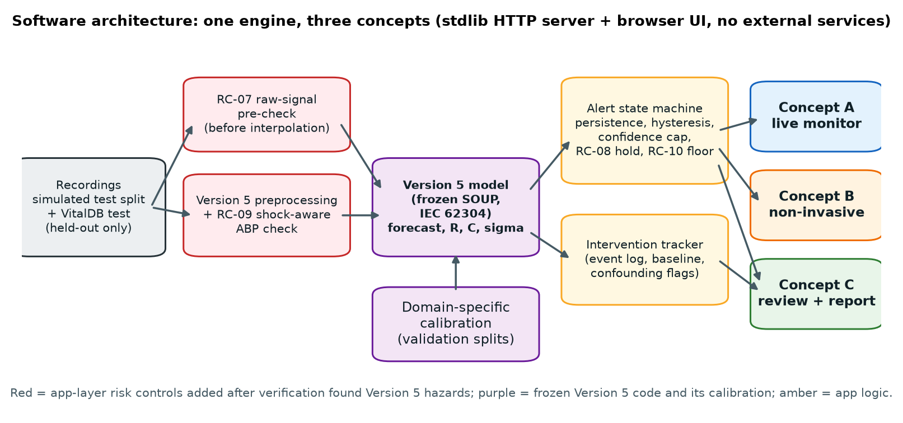

# 05 Prototype and software architecture

*BMED Chapter 7.10 (programming, connectivity and simulations), 7.12 (prototype review and documentation), 6.5.1 (proof-of-concept prototypes) and Chapter 12 / IEC 62304 (software life cycle).*

## 1. What was built

A single web application that runs all three concepts on one shared engine:

| Route | Concept | What the user does |
|-------|---------|--------------------|
| `#/` | Overview | Compare the three concepts; see the selected concept and why |
| `#/concept-a` | A: Integrated monitor | Stream a recording at 1–20× speed; alerts, forecast, R/C, intervention response, event log |
| `#/concept-b` | B: Non-invasive | Same layout and controls, ECG + PPG only, with a confidence-capped risk score |
| `#/concept-c` | C: Episode review | Generate a retrospective review; open the printable report; download CSV/JSON |
| `#/evidence` | – | Live verification results from `evaluation/results/` |
| `#/design/...` | – | This Design History File, rendered inside the app |

Run it with `scripts/run_app.sh` and open <http://127.0.0.1:8765>. The server binds to localhost only by default.

## 2. Design choices and why

| Choice | Reason (requirement or standard) |
|--------|----------------------------------|
| Python standard-library HTTP server; plain JavaScript with no framework and no CDN | Minimises SOUP (IEC 62304 §8); works offline on a hospital network; nothing to patch |
| One engine for A, B and C | Fair comparison: differences come from the concept, not from implementation quality |
| Version 5 code vendored **unchanged** in `src/`; model SHA-256 compared with the verified value at start-up (mismatch = refuse to start, FMEA R-13) | Traceability to the verified model; frozen SOUP item |
| Risk controls added in the app layer (`app/engine/`), not inside the model | Each control can be switched on or off and tested separately (doc 07, hazard H-09 layers) |
| Replay of recorded waveforms through a streaming window | Same code path as live streaming; repeatable tests; no live patient data needed |
| Only held-out recordings in the demo library | A demo on training data would overstate performance |
| A and B share an identical layout | IEC 60601-1-8 / BMED 8.2.5.3: alarm position and controls must not move between modes |
| In-house Markdown renderer with escaping | Docs cannot inject script; no extra dependency |

## 3. Engine modules (`app/engine/`)

| Module | Responsibility | Key requirement |
|--------|----------------|-----------------|
| `config.py` | All thresholds and constants in one place: MAP 70 / 65 / 55, persistence 2 up / 3 down, hysteresis 2 mmHg, 10 s window, 15 s horizon | SPEC-02/03/04 |
| `recordings.py` | Load held-out simulated and VitalDB recordings; detect intervention onsets (sample-and-hold of sparse pump data, for event detection only) | SPEC-09 |
| `model_service.py` | Wraps Version 5 `HemodynamicPredictor`; RC-07 raw pre-check; RC-09 shock-aware ABP check; domain-specific bias and sigma | SPEC-07, 11, 15 |
| `signal_checks.py` | `abp_artifact_free`: rejects only true artefacts (steps > 80 mmHg, flat runs ≥ 0.2 s, pulse pressure < 5, impossible values) | SPEC-15 |
| `alerting.py` | IEC 60601-1-8 style alert state machine: levels, priorities, persistence, hysteresis, confidence cap, RC-08 fail-safe hold, RC-10 measured-pressure floor, technical SIGNAL CHECK, plain-language reason | SPEC-02–04, 07, 14, 15 |
| `intervention.py` | Event-log-driven response tracker: 30 s baseline, response window 30–60 s after onset, ΔMAP ≥ 5 mmHg or ΔR ≥ 10%, confounding flags | SPEC-09 |
| `session.py` | `ReplaySession`: one update per second → tick (forecast, alert, R, C, interventions, waveforms) | SPEC-10 |
| `review.py` | Concept C: whole-record review, episodes, narrative, server-side SVG report, CSV/JSON | SPEC-13 |

### Alert logic (Concept A)

| Level | Priority (IEC 60601-1-8) | Raised when (forecast MAP over the next 15 s) |
|-------|--------------------------|-----------------------------------------------|
| STABLE | none | ≥ 70 mmHg |
| WATCH | low | < 70, or falling ≥ 10 mmHg in 15 s |
| DETERIORATING | medium | < 65 (treatment target) |
| CRITICAL | high | < 55 |
| SIGNAL CHECK | technical alarm | no usable forecast and no usable measurement |

- **Escalation** needs 2 consecutive updates; **de-escalation** needs 3 updates and a 2 mmHg margin.
- **Confidence cap:** a Low-confidence estimate can raise at most WATCH; Moderate, at most DETERIORATING.
- **RC-08** never lets a lower-confidence estimate lower an alert.
- **RC-10** never shows a level below what the measured arterial MAP itself indicates.

### Uncertainty and risk score

- σ is the calibrated forecast error (RMSE) for the active input regime and domain, fitted on validation data only.
- P(MAP < 65) = Φ((65 − forecast) / σ).
- Confidence: σ ≤ 12 mmHg → High; ≤ 20 → Moderate; otherwise Low.

## 4. Software of unknown provenance (SOUP, IEC 62304 §8)

| Item | Version (tested) | Used for | Risk if it fails | Mitigation |
|------|------------------|----------|------------------|------------|
| Version 5 model + code (`src/`) | SHA-256 6fbec94f… | Forecast, R, C, quality | Wrong forecast (hazards H-09, R-01) | Frozen; app-layer controls RC-07 to RC-10; full verification |
| PyTorch | 2.11.0 | Model inference | Wrong numbers / crash | Pinned; verification re-run on any upgrade; ONNX export available |
| NumPy | 2.5.3 | Signal arrays | Wrong numbers | Pinned |
| SciPy | 1.18.1 | Filters (Version 5 preprocessing) | Distorted waveform | Pinned |
| pandas (3.0.6), tqdm | as installed | Imported by Version 5 utilities | Import failure | Pinned |
| Python | 3.14 (3.10+ supported) | Runtime | – | – |
| Evaluation only: scikit-learn, matplotlib, Playwright | – | AUROC, figures, UI tests | Not shipped in the runtime | – |

The browser side uses no third-party code.

## 5. HTTP interface

| Method and path | Purpose |
|-----------------|---------|
| `GET /api/meta` | Model info, concepts, thresholds |
| `GET /api/recordings` | Held-out demo library |
| `POST /api/session` `{recording_id, concept, start_sec}` | Start a replay session (at most 24 at once, idle timeout 30 min) |
| `POST /api/session/<id>/step` `{n ≤ 60}` | Advance n updates |
| `POST /api/session/<id>/event` `{type}` | Clinician-marked intervention (Concept A) |
| `DELETE /api/session/<id>` | End the session |
| `GET /api/review/<id>[/report.html, /timeline.csv, /review.json]` | Concept C outputs |
| `GET /api/verification`, `/api/selection`, `/api/docs[/name]` | Evidence and DHF |

Hardening, all verified:

- request bodies over 64 KB are rejected;
- path traversal is blocked (tested with `--path-as-is`);
- NaN is serialised as `null`;
- unknown IDs return 404.

## 6. Demo library (held-out only)

| ID | Story | Source |
|----|-------|--------|
| synthetic_4993 | Septic shock, 85 → 49 mmHg | Simulated test split |
| synthetic_668 | Vasopressor rescue, 87 → 39 → 81 | Simulated test split |
| synthetic_776 | Mixed shock (stiff arteries), 89 → 49 → 70 | Simulated test split |
| synthetic_705 | Fluid challenge | Simulated test split |
| synthetic_4928 | Haemorrhage and resuscitation | Simulated test split |
| synthetic_792 | Stable control | Simulated test split |
| synthetic_830 | Low compliance | Simulated test split |
| vitaldb_5875, vitaldb_6131 | Surgery with vasopressor, hypotension | VitalDB test cases |
| vitaldb_6129 | Untreated hypotension | VitalDB test cases |
| vitaldb_5958 | Stable surgery | VitalDB test cases |

They are chosen by `scripts/build_demo_data.py` using fixed rules, for example a normotensive start of 75–95 mmHg for deterioration stories.

## 7. Performance

| Metric | Value | Spec |
|--------|-------|------|
| CPU latency per update, p50 / p95 / max | 11.9 / 175 / 318 ms | SPEC-10 ≤ 1000 ms marginal, ≤ 100 ideal → PASS (marginal) |
| GPU latency per update, p50 / p95 | 2.5 / 3.0 ms | – |
| Concept C throughput | 5.7 s of compute per monitored hour (2 s step, GPU) | – |

## 8. Prototype review (BMED 7.12)

| Question | Answer |
|----------|--------|
| What did the prototype prove? | The model can drive a real-time, explained, fail-safe alert UI on CPU hardware; the three concepts can be compared on equal terms |
| What did it disprove? | That Version 5's own quality gate is safe (R-01, H-09); that non-invasive forecasting is ready (Concept B) |
| What is "looks-like" vs "works-like"? | Works-like for the software logic. Looks-like for monitor integration (replay instead of a live HL7 / IEEE 11073 feed) |
| What would a production version need? | Live monitor interface; IEC 62304 class C process; cybersecurity (FDA 2023 guidance); summative usability study |
