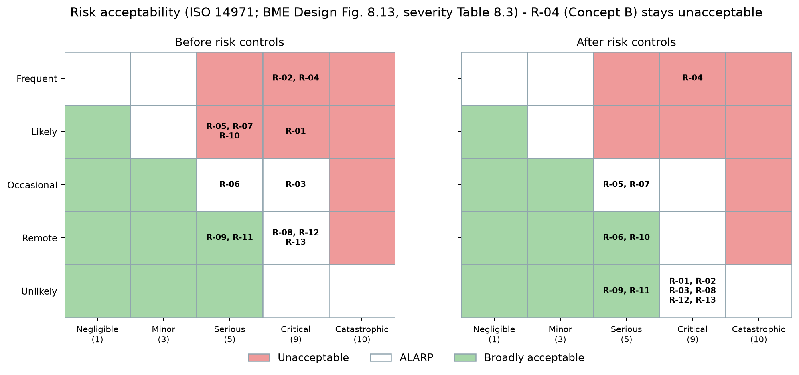
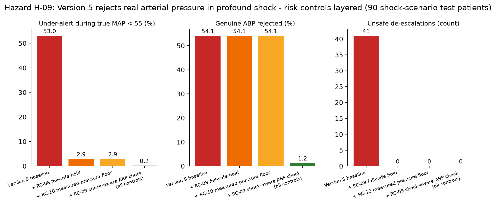

# 06 Usability and risk management

*BMED Chapter 8.2 (design for usability: users, use environment, user interfaces, Nielsen heuristics 8.2.5.2, alarm-design lesson 8.2.5.3) and 8.9 (design risk management: ISO 14971, FMEA, risk evaluation and control).*

## Part 1: Usability

### 1.1 Users and use environment (BMED 8.2.3, 8.2.4)

| | Concept A / B (live) | Concept C (review) |
|---|---|---|
| Users | ICU and OR nurses, anaesthesiologists, intensivists | Next-shift clinicians, quality officers, researchers |
| Environment | Noisy, interrupted, time-critical; glanced at from across the bed; gloves | Desk, unhurried; printed handoff sheets |
| Key task | "Is my patient getting worse, why, and is my treatment working?" in < 3 s | "What happened during this episode?" in < 1 min |
| Error that matters most | Missing a real deterioration; ignoring an alert because of fatigue | Misreading the report as real-time status |

### 1.2 Interface decisions traced to standards and the book

| Decision | Source |
|----------|--------|
| Alert colours follow IEC 60601-1-8 priorities (cyan for low, yellow for medium, red for high), each with a distinct **shape icon**, so priority is readable without colour vision | IEC 60601-1-8; accessibility |
| The alert banner is always in the same place, with the same controls, in A and B | BMED 8.2.5.3: alarm-silence and power buttons must not swap position between modes (consistency lesson) |
| Every alert carries a plain-language **reason** and P(MAP < 65) | FDA CDS guidance (the user can review the basis); Nielsen 1 |
| Technical alarm (SIGNAL CHECK) is separate from physiological alarms | IEC 60601-1-8 technical vs physiological alarm conditions |
| A "held" indicator appears when RC-08 keeps an alert up | Visibility of system status; prevents confusion when the forecast recovers before the alert does |
| Forecast shown as MAP line plus ±σ band plus individual 1 s pressure samples | Shows uncertainty honestly; Concept B's wide band makes its low confidence visible |
| R and C labelled "relative trends", with the verification caveat on screen | Prevents over-interpretation (FMEA R-07) |
| Two-click confirmation to mark an intervention | Error prevention |
| Verification overlay (true future MAP) off by default and labelled "not available at the bedside" | Prevents demo artefacts being mistaken for features |
| Research-prototype banner on every page | Intended-use clarity (ethics, doc 08) |

### 1.3 Heuristic evaluation (BMED 8.2.5.2, Nielsen's 10 heuristics)

Formative, internal evaluation by the design team on the working prototype (`evaluation/heuristic_evaluation.json`). Result: **live views 9 / 10, review 10 / 10** (SPEC-12 marginal ≥ 8 → PASS).

| # | Heuristic | Live views (A, B) | Evidence | Review (C) | Evidence |
|---|-----------|-------------------|----------|------------|----------|
| 1 | Visibility of system status | met | Alert banner always in the same position with level, reason, confidence and 'held' indicator; per-update latency, regime and signal quality shown; playback clock. | met | Progress state while the review runs; summary tiles show monitored time, abstention % and episode count. |
| 2 | Match between system and the real world | met | Bedside-monitor layout (ECG II / PLETH / ART strips, dark monitor panel); clinical units (mmHg); thresholds stated as 65 target / 55 critical. | met | Plain-language handoff narrative written in clinical terms (time at CRITICAL, MAP change after vasopressor). |
| 3 | User control and freedom | partial | Play/pause, step, restart, speed and start position are available, but a confirmed intervention mark cannot be undone (only restarted). Design iteration item. | met | Any recording can be re-reviewed; exports open separately without losing the page. |
| 4 | Consistency and standards | met | IEC 60601-1-8 priority colours plus shape icons (colour-blind safe); identical layout and controls for Concepts A and B so the alert banner never moves (BME Design 8.2.5.3 alarm-silence lesson). | met | Same level colours and names as the live views and the printable report. |
| 5 | Error prevention | met | Two-click confirmation for marking an intervention (auto-cancels after 4 s); server validates every request (size limit, unknown IDs, session cap). | met | Only held-out recordings can be selected; generation is a single explicit action. |
| 6 | Recognition rather than recall | met | Legends on every chart; 'How alerts work' panel defines every level; reason text explains why the level is shown. | met | Episode table lists start, end, worst level and lowest MAP - no need to remember the timeline. |
| 7 | Flexibility and efficiency of use | met | Keyboard shortcuts (Space, →), playback speeds 1-20x, start presets at the clinically interesting moment. | met | Printable report for handoff plus CSV/JSON for audit and research. |
| 8 | Aesthetic and minimalist design | met | One dominant alert banner; R/C and log are secondary; verification overlay hidden by default. | met | Summary first, details below; report fits on printed pages. |
| 9 | Help users recognise, diagnose and recover from errors | met | Errors shown in a dedicated alert box with the action to take ('Press Restart to begin again'); SIGNAL CHECK tells the user to check sensors. | met | Error message shown in place if a review cannot be generated. |
| 10 | Help and documentation | met | Inline help panel; design documents (this Design History File) readable inside the app. | met | Report states method, thresholds and limitations; design documents available in the app. |

**Finding for iteration:** heuristic 3 (user control and freedom) is only partly met. A mistakenly marked intervention cannot be undone without restarting, and it would distort the response assessment. Planned fix: an "undo last mark" action within 60 s, recorded in the event log.

**Limitation:** a heuristic evaluation by the designers is not a usability test. IEC 62366-1 requires a summative evaluation with representative users (doc 07 §8).

## Part 2: Risk management (ISO 14971, BMED 8.9)

### 2.1 Method

- Risk = probability of occurrence × severity of harm (BMED 8.9.1).
- Severity uses BMED Table 8.3: Negligible 1, Minor 3, Serious 5, Critical 9, Catastrophic 10.
- Probability levels and acceptability regions follow BMED Figure 8.13 (Unacceptable / ALARP / Broadly acceptable). The regions are reconstructed from the figure and stored in `evaluation/fmea.json`.
- BMED notes that academic projects often lack the data needed to estimate probability. Here, **probabilities are taken from verification measurements wherever one exists** (the evidence columns). Elsewhere they are design-team judgement and are marked as such.
- A control counts as "verified" only when a test shows the effect.

**Summary:** 13 risks.

- **Before controls:** 6 unacceptable, 5 ALARP, 2 broadly acceptable.
- **After controls:** 1 unacceptable, 8 ALARP, 4 broadly acceptable.

The one risk that remains unacceptable is **R-04 (Concept B false reassurance)**. BMED 8.9.2 says such a risk must be reduced or "the design must be abandoned". This is one of the engineering reasons Concept B is not selected.

### 2.2 FMEA / risk table

| ID | Concepts | Item | Failure mode | Effect | Sev. | P before | Risk before | Risk controls | Status | P after | Risk after | Evidence after |
|----|----------|------|--------------|--------|------|----------|-------------|---------------|--------|---------|------------|----------------|
| R-01 | A, B, C | Signal-quality gate | PPG drop-out (sensor off / motion) passes the Version 5 gate because the gate checks data after interpolation | Forecast built from interpolated, fabricated waveform; false reassurance or false alarm | Critical (9) | Likely | **Unacceptable** | RC-07 raw-signal pre-check before interpolation (abstain if PPG > 30% missing; drop ECG/ABP channel if > 30% missing); SIGNAL CHECK technical alarm, never a physiological alert, when abstaining | implemented + verified | Unlikely | **ALARP** | 100% of 595 corrupted windows handled; 0 physiological alerts from abstained windows (quality_gate.csv) |
| R-02 | A | ABP plausibility check (hazard H-09) | Version 5 rejects genuine arterial pressure in profound shock (MAP < 40 or DBP < 20 treated as artefact) and silently falls back to the less accurate ECG + PPG regime | Forecast jumps upward (e.g. 68 vs true 42 mmHg); CRITICAL alert downgraded to WATCH during the most dangerous period | Critical (9) | Frequent | **Unacceptable** | RC-09 shock-aware ABP check: reject only true artefacts (flat line, steps, zero pulse pressure, impossible values); RC-10 measured-pressure floor: alert level never below what the measured arterial MAP itself indicates; RC-08 fail-safe hold: a lower-confidence estimate can never de-escalate an alert | implemented + verified | Unlikely | **ALARP** | Under-alert 0.18% (shock cohort) / 0.3% (all test patients); ABP rejected 1.2%; genuine-shock ABP retained 95%; damped/flush artefacts still rejected 100% |
| R-03 | A, B | Alert state machine | Alert de-escalates when the higher-confidence channel is lost rather than when the patient improves | False reassurance | Critical (9) | Occasional | **ALARP** | RC-08 fail-safe hold with 'held' indicator on screen; 3-update de-escalation persistence with 2 mmHg hysteresis | implemented + verified | Unlikely | **ALARP** | 0 unsafe de-escalations |
| R-04 | B | Non-invasive forecast | ECG + PPG estimate of MAP is biased and imprecise (no pressure reference) | Missed hypotension (false reassurance) or false alarms | Critical (9) | Frequent | **Unacceptable** | Confidence cap: low-confidence estimate can raise at most WATCH; Labelling: 'trend only - not for treatment decisions'; Domain-specific bias calibration | implemented + verified | Frequent | **Unacceptable** | Cap removes false alarms but under-alert during true MAP < 55 is 100%: the risk cannot be reduced to ALARP with the current model -> Concept B not selected (Section 8.9.2: 'the design must be abandoned' or redesigned) |
| R-05 | A | Alarm management | Frequent WATCH-level alerts on real patients | Alarm fatigue; a true alarm is ignored (Sendelbach & Funk 2013) | Serious (5) | Likely | **Unacceptable** | Persistence (2 updates) and hysteresis (implemented); IEC 60601-1-8 priorities: WATCH = low priority, visual only (implemented in colour/shape coding); PLANNED: make WATCH a non-alarming information signal and tune the WATCH threshold on validation data | partially implemented | Occasional | **ALARP** | ALARP pending the planned control and usability validation; tracked as SPEC-04 FAIL |
| R-06 | A, C | Intervention response | Vasopressor and fluid given together; combined input channel cannot separate their effects | Response attributed to the wrong treatment | Serious (5) | Occasional | **ALARP** | Event-log driven tracker (clinician-confirmed events); Confounding flag shown when treatments overlap; Status reports a trend only, never a recommendation | implemented + verified | Remote | **Broadly acceptable** | 96% agreement with ground truth on unconfounded events (intervention_agreement.csv) |
| R-07 | A, B, C | R / C estimation | Real-data fine-tuning eroded vascular-state estimates (within-patient correlation R 0.54, C 0.03) | Clinician over-interprets an unreliable resistance/compliance value | Serious (5) | Likely | **Unacceptable** | Displayed as relative trends with an on-screen caveat; Not used by the alert logic; PLANNED: multi-task fine-tuning that preserves R/C | implemented (warning only) | Occasional | **ALARP** | ALARP for a research prototype; must be fixed before clinical use |
| R-08 | A, B, C | Output wording | Software text drifts into recommending therapy | Device becomes prescriptive (changes regulatory class; automation bias) | Critical (9) | Remote | **ALARP** | Outputs restricted to observations and trends; Automated wording scan of every alert reason and review narrative (static_checks.py, SPEC-14) | implemented + verified | Unlikely | **ALARP** | 0 prescriptive phrases (static_checks.json) |
| R-09 | A, B | Computation | Update latency exceeds the 1 s update period on bedside CPU hardware | Stale display | Serious (5) | Remote | **Broadly acceptable** | CPU latency verified (p95 175 ms); Latency shown per update; clock shows playback position | implemented + verified | Unlikely | **Broadly acceptable** | SPEC-10 PASS (marginal) |
| R-10 | A | Domain shift | Calibration fitted on simulation does not transfer to real patients | Mis-calibrated uncertainty band and risk score | Serious (5) | Likely | **Unacceptable** | Domain-specific calibration fitted on VitalDB validation cases only | implemented + verified | Remote | **Broadly acceptable** | Real MAE 5.6 -> 4.7 mmHg after calibration (held-out test cases) |
| R-11 | C | Retrospective report | Report used as a real-time monitor | Delayed response to deterioration | Serious (5) | Remote | **Broadly acceptable** | Banner on every report: retrospective decision-support summary, not a diagnosis; No alarm colours in report header | implemented | Unlikely | **Broadly acceptable** | inspection |
| R-12 | A, B, C | Patient identification | Wrong recording reviewed or monitored | Decisions made on another patient's data | Critical (9) | Remote | **ALARP** | Recording title and source always shown in page header and report; Changing patient resets the session | implemented | Unlikely | **ALARP** | inspection |
| R-13 | A, B, C | Configuration control | Unverified model weights loaded (wrong file, corrupted copy, or Version 5's silent fallback to the synthetic-only checkpoint) | All verification evidence is void; real-patient MAE of the synthetic-only model is ~5x worse | Critical (9) | Remote | **ALARP** | SHA-256 of the loaded checkpoint compared with the verified value at start-up; mismatch refuses to start; Checksum shown in the app header and stored in every result file | implemented + verified | Unlikely | **ALARP** | Tested: correct checkpoint loads; wrong expected hash -> RuntimeError, server does not start |

### 2.3 Hazard H-09 in detail: the most important verification finding

**What happens.** The Version 5 quality gate treats arterial pressure as implausible when MAP < 40, DBP < 20 or SBP < 60. In profound shock, *real* pressure falls into that range. The gate then discards the arterial line and the model falls back to the ECG + PPG regime, which over-estimates MAP. In one case the forecast was 68 mmHg against a true 42 mmHg, and the alert dropped from CRITICAL to WATCH. **The less information the system had, the more reassuring it became**, which is the opposite of fail-safe.

**How it was found.** By stratifying the verification by true MAP band and measuring under-alerting during true MAP < 55 mmHg (now SPEC-15), instead of looking only at average accuracy.

**Controls, layered and each verified separately** (90 shock-scenario test patients, `evaluate_concepts.py` H-09 phase):

| Configuration | Under-alert in true MAP < 55 | Genuine ABP rejected | Unsafe de-escalations | Forecast MAE while critical |
|---|---|---|---|---|
| Version 5 baseline | 53.0% | 54.1% | 41 | 21.2 mmHg |
| + RC-08 fail-safe hold | 2.9% | 54.1% | 0 | 21.2 mmHg |
| + RC-10 measured-pressure floor | 2.9% | 54.1% | 0 | 21.2 mmHg |
| + RC-09 shock-aware ABP check (all controls) | 0.2% | 1.2% | 0 | 5.4 mmHg |

- **RC-08, fail-safe hold:** evidence of lower confidence than the evidence that raised an alert can never lower it. This alone removes every unsafe de-escalation.
- **RC-10, measured-pressure floor:** the displayed level is never below what the measured arterial MAP indicates. As a result, A can never be less safe than the conventional monitor on the same data.
- **RC-09, shock-aware ABP check:** reject only true artefacts (flat line, step change, zero pulse pressure, impossible values), not low pressure. Genuine ABP is kept in 95% of shock windows (Version 5: 52.5%), while line-flush and damped-trace artefacts are still rejected in 100% of cases.

**Residual risk:** under-alert is 0.18% of critical time in the shock cohort and 0.3% across all test patients (SPEC-15 marginal ≤ 5% → PASS; ideal 0 not yet met). It is ALARP, and each residual tick is logged in `ticks_synthetic_test.csv` for review.

### 2.4 Risk–benefit statement

For **Concept A**, the residual risks are ALARP and the benefits are:

- earlier warning at about half of real hypotension onsets;
- a reason for every alert;
- treatment-response feedback;
- protection, by design, against being less safe than the existing monitor (RC-10).

The benefit outweighs the residual risk for a supervised research deployment. Clinical deployment requires closing R-05 (alarm burden) and R-07 (R/C reliability) and a summative usability study.
