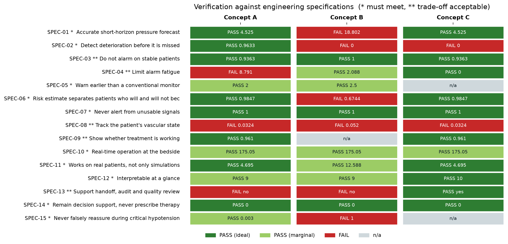
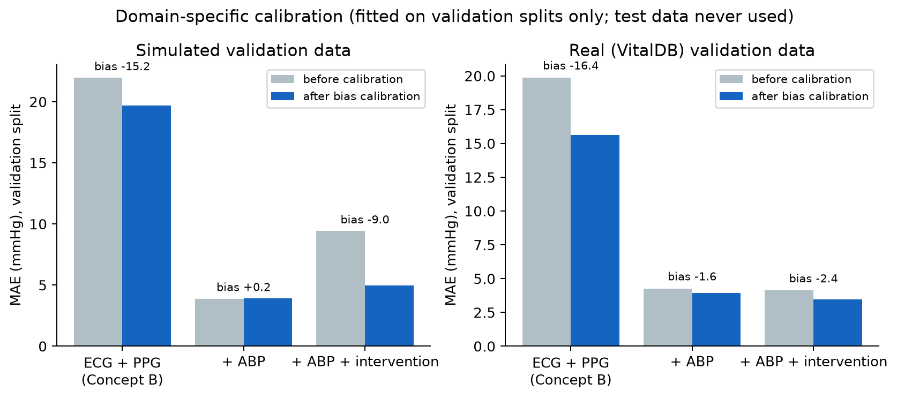
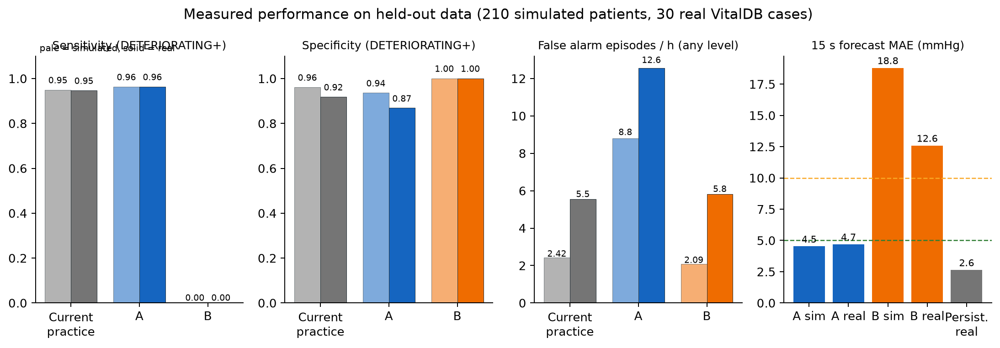
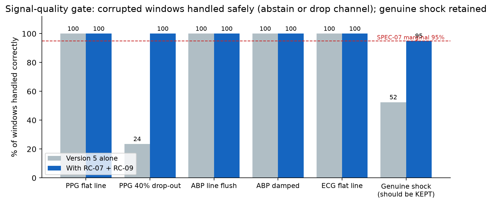

# 07 Verification and validation

*BMED Chapter 9: verification ("did we make the product right?", design outputs vs design inputs, 9.5) and validation ("did we make the right product?", user needs in the use environment, 9.6), with analysis and interpretation of test data (9.7).*

## 1. Test design

| Principle | How it was applied |
|-----------|--------------------|
| Test on data the model never saw | Simulated patients from Version 5's **test split** (split by case ID, so no patient overlap); VitalDB cases from Version 5's **held-out test list** |
| Calibrate only on validation data | Bias and σ were fitted on 140 simulated validation patients and 25 VitalDB validation cases, then frozen before any test |
| Representative cohort | 210 simulated test patients, 30 per scenario: septic shock, haemorrhage/resuscitation, vasopressor rescue, fluid challenge, mixed shock with stiff arteries, low compliance, stable. Plus 30 real VitalDB surgical cases (14.8 monitored hours, 178 hypotension onsets) |
| Test the deployed configuration | 1 s update rate, all risk controls on, the same code path as the app (`ReplaySession`) |
| Fair comparator | The datum (threshold alarm on measured MAP) runs through the **same** alert state machine |
| Test the controls, not just the model | Each risk control can be switched off; before/after runs are reported (quality gate, H-09 layers) |
| Fixed seed, scripted | `seed = 2026`; `scripts/run_verification.sh` reproduces every number (about 15 min) |

Run log: `evaluation/results/evaluation_run.log` (generated 2026-10-02 14:34:12, 13.8 min, model SHA-256 `6fbec94f8b40570b…`).

## 2. Verifier defects found and fixed (test-method validation)

BMED 9.8 stresses that the test method itself must be competent. Four problems with the first version of the verifier would have flattered the design:

1. **The alarm-metric trap.** Counting only DETERIORATING-and-above false alarms let a design sit permanently at WATCH and still look quiet. Fix: SPEC-04 counts all levels, and WATCH specificity and time spent alarming are reported.
2. **An unfair datum.** The first datum had no persistence logic and was evaluated at a 2 s step. Fix: the datum uses the identical state machine at the deployed 1 s step, and lead time is a *paired*, per-onset comparison.
3. **Calibration leakage risk.** Calibration and test are separate splits, and the calibration file records its source.
4. **Average accuracy hid a hazard.** Overall MAE looked fine while the system under-alerted in profound shock (H-09). Fix: stratified analysis and the new SPEC-15.

## 3. Verification results against every specification

| Spec | Pri. | Metric | Ideal / marginal | A | B | C |
|---|---|---|---|---|---|---|
| SPEC-01 | * | MAE of forecast MAP vs true MAP over the next 15 s (held-out synthetic) (mmHg) | 5 / 10 | 4.525 **PASS (ideal)** | 18.802 **FAIL** | 4.525 **PASS (ideal)** |
| SPEC-02 | * | Sensitivity of DETERIORATING-or-higher alert for true future MAP < 65 mmHg (fraction) | 0.9 / 0.8 | 0.9633 **PASS (ideal)** | 0 **FAIL** | 0 **FAIL** |
| SPEC-03 | ** | Specificity of DETERIORATING-or-higher alert (fraction) | 0.9 / 0.8 | 0.9363 **PASS (ideal)** | 1 **PASS (ideal)** | 0.9363 **PASS (ideal)** |
| SPEC-04 | ** | False alert episodes per monitored patient-hour (per hour) | 1 / 3 | 8.791 **FAIL** | 2.088 **PASS (marginal)** | 0 **PASS (ideal)** |
| SPEC-05 | * | Median paired lead-time advantage of the first WATCH-or-higher alert over a conventional threshold monitor with identical alarm management, per hypotension onset (MAP < 65) (s) | 10 / 0 | 2 **PASS (marginal)** | 2.5 **PASS (marginal)** | – **n/a** |
| SPEC-06 | * | AUROC of P(MAP < 65) for true future MAP < 65 (AUROC) | 0.9 / 0.8 | 0.9847 **PASS (ideal)** | 0.6744 **FAIL** | 0.9847 **PASS (ideal)** |
| SPEC-07 | * | Corrupted windows handled safely (abstain or drop the bad channel) (fraction) | 1 / 0.95 | 1 **PASS (ideal)** | 1 **PASS (ideal)** | 1 **PASS (ideal)** |
| SPEC-08 | ** | Median within-patient correlation of estimated R and C with ground truth (r) | 0.8 / 0.5 | 0.0324 **FAIL** | 0.052 **FAIL** | 0.0324 **FAIL** |
| SPEC-09 | ** | Agreement of intervention-response status with ground truth (fraction) | 0.9 / 0.75 | 0.961 **PASS (ideal)** | – **n/a** | 0.961 **PASS (ideal)** |
| SPEC-10 | * | 95th-percentile per-update latency on CPU (no GPU at bedside) (ms) | 100 / 1000 | 175.05 **PASS (marginal)** | 175.05 **PASS (marginal)** | 175.05 **PASS (marginal)** |
| SPEC-11 | * | MAE of forecast MAP vs arterial line on held-out VitalDB cases (mmHg) | 10 / 15 | 4.695 **PASS (ideal)** | 12.588 **PASS (marginal)** | 4.695 **PASS (ideal)** |
| SPEC-12 | * | Nielsen usability heuristics satisfied (heuristic evaluation) (of 10) | 10 / 8 | 9 **PASS (marginal)** | 9 **PASS (marginal)** | 10 **PASS (ideal)** |
| SPEC-13 | ** | Exportable episode report (printable + data export) (yes/no) | yes / yes | no **FAIL** | no **FAIL** | yes **PASS (ideal)** |
| SPEC-14 | * | Outputs containing treatment recommendations (count) | 0 / 0 | 0 **PASS (ideal)** | 0 **PASS (ideal)** | 0 **PASS (ideal)** |
| SPEC-15 | * | Share of windows with true MAP < 55 mmHg displayed only as STABLE or WATCH (fraction) | 0 / 0.05 | 0.003 **PASS (marginal)** | 1 **FAIL** | – **n/a** |

**Must-meet (\*) summary:** A passes all ten. B fails SPEC-01, 02, 06 and 15. C fails SPEC-02 by design (it does not alert in real time).
**Trade-off (\*\*) failures for A:** SPEC-04 alarm burden, SPEC-08 R/C tracking, SPEC-13 export. The SPEC-13 failure is closed by folding in C's report (doc 04 §9).

How the static specifications were verified (`evaluation/static_checks.py`):

- **SPEC-12:** heuristic evaluation (doc 06).
- **SPEC-13:** the report, CSV and JSON code paths were exercised for every demo recording.
- **SPEC-14:** every sentence shown to a user (5914 in A, 4098 in B, 73 in C, including the full report text) was scanned for prescriptive phrasing. 0 matches. The scanner was checked with positive controls, for example "Give a fluid bolus now" is caught.

## 4. Forecast accuracy and calibration

| | Simulated test | Real test (VitalDB) |
|---|---|---|
| Concept A MAE / RMSE | 4.525 / 6.624 mmHg | 4.695 / 10.985 mmHg (uncalibrated 5.607) |
| Concept A within ±5 / ±10 mmHg | 68% / 90% | 78% / 92% |
| Concept B MAE | 18.802 mmHg | 12.588 mmHg |
| Persistence (current MAP carried forward 15 s) | 2.12 mmHg (same ticks; model 4.27) | 2.64 mmHg |
| While MAP changes > 5 mmHg in 15 s (n = 3454) | model 8.54 vs persistence 9.97 mmHg | – |

**Interpretation.**

- **Calibration does not transfer between domains.** The bias of the ECG + PPG regime is about −15 mmHg in both domains. The intervention regime's bias, however, is −9.0 mmHg in simulation but only −2.4 mmHg on real data, so a single calibration would mis-correct real patients. Domain-specific calibration lowers real MAE from 5.607 to 4.695 mmHg.
- **Persistence wins on average; the model wins during change.** At a 15 s horizon, "the pressure stays as it is" is more accurate overall. The model adds accuracy only while pressure is changing. This is the strongest argument for a longer horizon in the next iteration, and it is why lead time, not MAE, is the critical measure of benefit.

## 5. Alert performance

| Metric | A sim | A real | B sim | B real | Datum sim | Datum real |
|--------|-------|--------|-------|--------|-----------|------------|
| Sensitivity (DETERIORATING+) | 0.9633 | 0.9636 | 0.0 | 0.0 | 0.9499 | 0.9471 |
| Specificity (DETERIORATING+) | 0.9363 | 0.8699 | 1.0 | 1.0 | 0.9613 | 0.9188 |
| Specificity (WATCH+) | 0.7945 | 0.6529 | 0.9018 | 0.812 | 0.8746 | 0.6888 |
| AUROC of P(MAP < 65) | 0.9847 | 0.9551 | 0.6744 | 0.591 | – | – |
| False alarm episodes / h (any level) | 8.791 | 12.568 | 2.088 | 5.811 | 2.418 | 5.541 |
| Hypotension onsets missed | 0 / 59 | 5 / 178 | 59 / 59 | 178 / 178 | 0 / 59 | 7 / 178 |

**Paired lead time of A over the datum (positive = A earlier):**

| | Simulated, WATCH | Simulated, DETERIORATING | Real, WATCH | Real, DETERIORATING |
|---|---|---|---|---|
| Paired onsets | 59 | 59 | 178 | 171 |
| Median / mean advantage | 2.0 / 2.1 s | 2.0 / 4.5 s | 0.0 / 1.6 s | 0.0 / 8.7 s |
| Share of onsets where A is earlier | 63% | 80% | 17% | 46% |
| Detected only by A / only by datum | 0 / 0 | 0 / 0 | 0 / 0 | 2 / 0 |

**Interpretation.**

- **Discrimination is strong and transfers to real patients** (AUROC 0.98 → 0.96).
- **A beats the monitor at the decision-relevant level, but only by a little.** At DETERIORATING, A is earlier at 80% of simulated and 46% of real onsets. It catches 2 real onsets the monitor misses and misses none that the monitor catches. The typical advantage is seconds, because the forecast horizon is 15 s.
- **A's alarm burden on real data is about twice the datum's at WATCH level.** This is the cost of predictive alerting at this horizon (SPEC-04 FAIL, FMEA R-05).
- **B never reaches DETERIORATING.** Its confidence cap stops it, which removes false alarms but also makes it blind: all 178 real onsets are missed at that level.

## 6. Physiological state tracking (R, C)

| | Within-patient correlation with truth | Pooled correlation |
|---|---|---|
| Concept A: R | 0.5381 | 0.6152 |
| Concept A: C | 0.0324 | 0.3619 |
| Concept B: R / C | 0.052 / 0.0661 | – |

**Finding:** fine-tuning Version 5 on real VitalDB pressure, which is what made real-patient accuracy good, weakened the physics outputs, especially compliance. An earlier comparison run during this project (2 s step; not regenerated by the current scripts) showed the synthetic-only checkpoint tracking R and C much better (within-patient r ≈ 0.71 / 0.72) but with real-patient MAE ≈ 24 mmHg. The deployed checkpoint therefore trades R/C fidelity for real-world accuracy. That is the right trade for an alerting device, but it fails SPEC-08.

**Control:** R and C are displayed as relative trends with an on-screen caveat and are never used by the alert logic. **Recommendation:** multi-task fine-tuning with an R/C consistency loss on simulated data.

## 7. Safety-function verification

**Signal-quality gate (SPEC-07):** 120 test windows per corruption type, plus clean and genuine-shock controls.

| Condition | Version 5 alone | With RC-07 + RC-09 |
|-----------|-----------------|--------------------|
| PPG flat line, ECG flat line, ABP line flush, ABP damped | 100% handled | 100% handled |
| PPG 40% drop-out | **23.5%** handled | 100% handled |
| Genuine shock ABP kept (should not be rejected) | 52.5% | 95% |
| Physiological alerts raised from abstained windows | 0 | 0 |

**Hazard H-09 layers:** see doc 06 §2.3. Under-alert fell from 53.0% to 0.18% of critical time; unsafe de-escalations from 41 to 0.

**Intervention response (SPEC-09):** 124 treatment events in the simulated test set. The unconfounded events (one treatment at a time) are the specification measure; agreement on these is **96.1%**. Confounded events (overlapping treatments) are flagged on screen and reported separately in `intervention_agreement.csv`.

**Performance (SPEC-10):** CPU p95 = 175.05 ms (marginal ≤ 1000, ideal ≤ 100 → PASS marginal); GPU p95 = 3.02 ms.

## 8. Validation: what has *not* been shown, and the plan

Verification shows that the outputs meet the design inputs on retrospective data. **Validation, meaning that the right product was built for real users in the real environment, has not yet been done.** The plan follows BMED 9.6 and IEC 62366-1:

| Stage | Question | Method | Acceptance |
|-------|----------|--------|------------|
| V1 Formative usability (done, internal) | Is the UI understandable? | Heuristic evaluation (doc 06) | ≥ 8/10 heuristics, met (9/10) |
| V2 Formative usability with clinicians | Can nurses read the alert and its reason correctly? | Think-aloud sessions on the replay app, 5–8 ICU nurses and anaesthesiologists (Nielsen: about 5 users reveal most usability problems) | Task success ≥ 90%; no use error on critical tasks |
| V3 Summative usability | Are use-related risks controlled? | IEC 62366-1 summative test, ≥ 15 users per user group, scenario-based (deterioration, artefact, treatment) | Zero critical use errors |
| V4 Retrospective clinical validation | Does it generalise? | Larger VitalDB / MIMIC cohorts, pre-registered endpoints (sensitivity, specificity, lead time, time-weighted hypotension) | SPEC-02/03/05/15 on the new cohort |
| V5 Prospective silent-mode study | Does it work live? | Run alongside standard care with the display hidden from clinicians; compare alerts with outcomes | Same specifications, live data; alarm burden measured |
| V6 Clinical utility | Does it change outcomes? | Randomised or stepped-wedge study: time below MAP 65 | IRB-approved protocol |

## 9. Threats to validity

- **Simulation is not reality.** The simulated cohort comes from Version 5's own physics generator, so agreement with it partly reflects shared assumptions. The real-data results are the more credible ones.
- **Single real dataset.** VitalDB covers surgical patients from one centre. ICU patients, other monitors and other populations are untested.
- **Small real test set:** 30 cases and 178 onsets. Confidence intervals are wide. For example, the 0.96 sensitivity comes from a modest number of events.
- **The intervention channel** on VitalDB is reconstructed from sparse pump data (train/deploy skew; FMEA R-10).
- **Heuristic evaluation by the designers** is biased toward a positive result.
